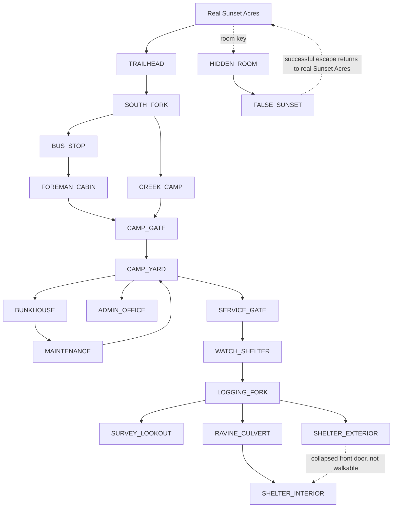

# Hollow Pines — fixed map, roads and locations

**Status:** Planned authored geography. This document defines where locations are and how they connect. Narrative truth and evidence are in [STORY.md](STORY.md); exact interaction/puzzle logic is in [PUZZLES.md](PUZZLES.md); existing engine behavior and implementation notes are in [FOREST.md](FOREST.md).

## Non-negotiable world generation model

- **Fixed across every expedition:** main trail geometry, trail forks, roads, fences, camp perimeter, site coordinates, building footprints/interiors, gates, clue sources, obstacles, and the relative positions of all named landmarks. A discovered foreman's cabin is always in the same place relative to the bus stop and camp entrance.
- **Procedural:** trees, understory, ambient props, fog and threats *between* the authored corridors; and the endless wilderness entered after a player becomes lost. Cosmetic variation must not bury, move, block or create alternative access around authored sites.
- **Stay on the established roads/trails or within an authored landmark:** you retain reliable navigation, even deep into the forest. **Stray far enough off the corridor:** the authored paths disappear, and the client transitions to a fully generated **lost-forest** state. The fixed map is no longer reachable by simply walking toward its old coordinates; escape requires a genuine family member, Nurse Ada or pet, or a safe ride on the Route 9 bus back to `CAMP_GATE` (`P04`). Do **not** make a player automatically lost merely for reaching a fixed distance from the forest entrance.
- **Normal return:** a player who stays on connected authored paths can walk back to the real Sunset Acres, however deep they explored. This is usually slower than finding a rescuer. Becoming lost removes that option.
- **No bypass by circling a gate:** place blocking fence and terrain so that going around a closed gate would mean leaving the path corridor and transitioning to lost forest, not coming out beyond the gate. Camp fences extend beyond the safe trail extent on either side of the main entrance. Gate colliders remain solid in authored map tiles.
- **Private forest:** site state, story encounters and temporary changes are per player; normal Sunset Acres remains multiplayer. `FALSE_SUNSET` is its own private scene, not a destructive edit of shared grounds.
- **No randomized placement for mandatory evidence.** Decorative props can shift; named objects and interactables listed below cannot.

## Connectivity graph (traversable connections)

**Graph conventions:** Lines are **authored** roads, trails, interior connections or room transitions, not random spawns. An ordinary line through a locked gate is traversable **only after its specified puzzle is solved**. The false Sunset connection is a temporary scene. The shelter exterior is visible early, but the front entrance stays blocked; its interior is entered through the ravine drainage route.

### Primary access gates

| Crossing | First blocked by | Opens using | Persistent after safe return? |
| --- | --- | --- | --- |
| `CAMP_YARD → ADMIN_OFFICE` | Locked office front door | `ITEM_ADMIN_KEY` from foreman's cabin (`P01`) | Yes |
| `CAMP_YARD → SERVICE_GATE` | Four-digit chained service gate | `P05` code derived from admin records | Yes |
| `SHELTER_EXTERIOR → SHELTER_INTERIOR` | Collapsed front entrance | **Never** through front | No: visual dead end |
| `RAVINE_CULVERT → SHELTER_INTERIOR` | Unidentified opening, debris and flooded sluice | `drainage_survey` from hidden room, then `P08` | Yes |
| `SA_ROOM → HIDDEN_ROOM` | Locked resident closet door | `ITEM_CLOSET_KEY` from survey lookout (`P06`) | Yes |
| `FALSE_SUNSET → SA_ROOM` | Impossible loop of wrong bedrooms | Recognition puzzle `P07` | Restores real scene; story event completed |

`CAMP_GATE` is the **open public entry** to the abandoned camp; don't add an extra key requirement here. The large fenced perimeter is for funneling the player through the camp and preventing bypass of its internal service gate.

## Location registry (canonical location IDs)

Names and IDs here are stable content keys. Layout coordinates should be authored in the game's tile coordinate system when MAP assets are built; the graph supplies topology, **not fabricated pixel/tile coordinates**. A location listed as early-accessible exists from the beginning even if its clues are gated.

### 01 — `SA_ROOM`: Sunset Acres bedroom (real)

- **Connections:** Existing multiplayer home/hallway; `TRAILHEAD` through the real property and outskirts; `HIDDEN_ROOM` via locked closet.
- **Landmarks:** family photo on wall; corkboard; personal storage/pet bed; small ordinary closet door visible from first session.
- **Interact:** prepare inventory, take or leave actual family photo, review/pin/arrange evidence, take stored quest items, unlock closet with key; cutscene replay. The final date-ordering board puzzle is **`P09`**.
- **Story:** the first safe place, then the stage for the hidden-room reveal; emotional ending after the last safe return.
- **Implementation:** owner-only story objects and progression. Room furniture is user-customizable. Never wipe, rearrange or harm the actual saved room for the echo sequence.

### 02 — `TRAILHEAD`: treeline path and early warning

- **Connections:** Real property ↔ `SOUTH_FORK`.
- **Visuals:** desaturated fringe, thinning sound, first fixed dirt trail; branches close in gradually. Pet growls/hisses near entry.
- **Interact:** old scratched trail marker with `own_warning` in the protagonist's handwriting; first brief distant Nora silhouette can flee across the edge of the screen. No need to chase her.
- **Story:** sets mood and reveals an unsettling familiar handwriting before naming Evie.
- **Puzzle:** none. Players should have time to acclimate; no forced dialogue immediately upon crossing.

### 03 — `SOUTH_FORK`: signed two-way junction

- **Connections:** `TRAILHEAD`, west to `BUS_STOP`, east to `CREEK_CAMP`.
- **Visuals:** weathered sign, road vs narrow creek trail; both ultimately converge at camp entrance.
- **Interact:** examine sign, get a simple trail-map sketch after visiting a branch.
- **Story:** the player can choose investigation order. This is navigation, not a puzzle.

### 04 — `BUS_STOP`: Route 9 shelter

- **Connections:** `SOUTH_FORK` ↔ `FOREMAN_CABIN`.
- **Visuals:** weathered timetable, unmaintained bench, old bus route; the forest occasionally produces a bus even though the last real service was 1979.
- **Fixed clues:** `route9_timetable`, `bus_warning`.
- **Optional mechanic `P04`:** the forest still runs the bus on its old crew timetable. A **scheduled** bus comes full (faint shapes of people in its windows) and takes you safely to the fixed **camp gate stop** (no gate bypass); so does any bus with your real pet aboard. An **empty** off-schedule bus is a lure: ride it alone and it lets you off deep in the lost forest. Never a way home.
- **Story:** first clear rule-horror site. The warning's literal author is the protagonist's earlier self.

### 05 — `FOREMAN_CABIN`: western road cabin

- **Connections:** `BUS_STOP` ↔ `CAMP_GATE`.
- **Visuals:** small office/overnight cabin, desk, coat hook, rotted paperwork, one usable key hook.
- **Fixed items:** `ITEM_ADMIN_KEY` and an old field envelope with `evie_card` and `evie_photo_before`; these personal objects were stashed by the protagonist during previous investigations.
- **Story:** first hint the protagonist was close to someone tied to these woods; introduces a found key before the locked office appears.
- **Puzzle:** take key and later apply at `ADMIN_OFFICE` (`P01`), including retrieving it from home storage if it was banked there.

### 06 — `CREEK_CAMP`: creek trail and Nora's temporary camp

- **Connections:** `SOUTH_FORK` ↔ `CAMP_GATE`.
- **Visuals:** creek crossing, bedroll, warm tea in a cup, recently snuffed fire, distinctive dented kettle.
- **Interact:** inspect campsite; early fleeting figure may run away. If player arrives after meeting Nora, the description recognizes her things. Changes in tea/fire state must track Nora's authored schedule, not imply an unexplained camp ghost.
- **Story:** introduces the idea that an **actual person** has recently been here. Optional discovery; Nora's required conversations are guaranteed elsewhere.
- **Puzzle:** none; optional recovery items or route sketches.

### 07 — `CAMP_GATE`: Hollow Pines perimeter entrance

- **Connections:** both `FOREMAN_CABIN` and `CREEK_CAMP` paths ↔ `CAMP_YARD`.
- **Visuals:** abandoned Hollow Pines Forestry Camp sign, open pedestrian gate, rusted fence continuing beyond navigable corridor, dated closure notice (1979).
- **Interact:** observe fencing and signage. Attempting to skirt the fence leads **off established trails** and then into lost forest; it must not let the player appear inside a gated zone.
- **Story:** shift from generic woods to a specific historical location.
- **Puzzle:** none at entrance. Keep this separate from the *locked* service gate deeper in camp.

### 08 — `CAMP_YARD`: camp courtyard hub

- **Connections:** `CAMP_GATE`, `BUNKHOUSE`, `MAINTENANCE`, `ADMIN_OFFICE`, `SERVICE_GATE`.
- **Visuals:** a courtyard surrounded by lived-in buildings, abandoned signage, empty flagpole, broken picnic benches.
- **Interact:** low-key camp inspection; **first mandatory real Nora conversation** here if not already met. Her second real conversation takes place on a later visit after `evie_case_1978` has been banked. The player should encounter Nora twice before the scripted fake rescue.
- **Story:** a real human who recognizes you, local history about the camp, and a small shared connection. No friendship meter or extended questline.
- **Puzzle:** hub for `P01`, `P02`, `P03`, `P05`.

### 09 — `BUNKHOUSE`: workers' sleeping quarters

- **Connections:** `CAMP_YARD` ↔ `MAINTENANCE` (a small back path makes a local exploration loop).
- **Visuals:** bunks, lockers, work clothes, dented mugs, photographs, noticeboard.
- **Fixed clues:** `jonah_journal` with ordinary entries first and the Bell contradictions later; policy note explaining locker numbers.
- **Optional puzzle `P02`:** Bell's locked locker, employee number **0416** obtainable from the dated fire report in `MAINTENANCE`.
- **Reward:** an old personal letter possibly written by a returned worker, leaving the impostors' wishes ambiguous; a close-up of Bell's hand before/after return.
- **Story:** gives the old disappearances a human eyewitness account.

### 10 — `MAINTENANCE`: maintenance and records shed

- **Connections:** `BUNKHOUSE` ↔ `CAMP_YARD`.
- **Visuals:** repair logs, charred equipment from a documented fire, mechanic's bench and old roller-shutter storage cage.
- **Fixed clue:** `bell_fire_record`: signed by Bell, proving he knew of a fire he later denied.
- **Optional puzzle `P03`:** operate a jammed pulley to lift a storage shutter for extra records/equipment. No improbably functioning 47-year-old generator needed.
- **Story:** contradicts Bell's reported memory of the fire; an evidentiary cross-check rather than random lore.

### 11 — `ADMIN_OFFICE`: primary archive and detective files

- **Connections:** `CAMP_YARD` through office door `P01`.
- **Visuals:** secured front door, filing cabinets, desk, bulletin board, archived report sleeves, case file box. A plainly separate **post-1987 personal archive cache** was stored here by the protagonist on earlier investigations; it explains why photographs and witness accounts from years after the 1979 closure are physically present in this abandoned office.
- **Fixed clues:** `evie_case_1978`, `evie_last_lead`, `evie_missing`, `search_roster`, `neighbor_statement`, `returned_evie_photo`, `returned_evie_journal`, optional `player_missing`.
- **Puzzle information:** night-crew/code registry needed for `SERVICE_GATE` (`P05`). No arbitrary random shuffle of filing locations.
- **Story:** establishes Evie's detective role, her 1987 disappearance, the protagonist's search, and the impossibility of the woman's later return. Some information becomes meaningful only with late evidence.
- **Persistence:** once safely unlocked, the door remains accessible on subsequent expeditions; the reports stay examinable.

### 12 — `SERVICE_GATE`: access to the deep forestry road

- **Connections:** `CAMP_YARD` ↔ `WATCH_SHELTER`.
- **Visuals:** chained vehicle gate, four-dial combination padlock, dead-end perimeter fence extending into the lost-forest margin.
- **Puzzle `P05`:** code **2714**, found by matching the gate's **NIGHT CREW** label to the registry in `ADMIN_OFFICE`.
- **Story:** meaningful progression restriction so the earlier camp must be investigated before the deep road.

### 13 — `WATCH_SHELTER`: deep-road gatehouse and enclosed refuge

- **Connections:** `SERVICE_GATE` ↔ `LOGGING_FORK`. The only maintained pedestrian footbridge through the stream cut passes by **or through the gatehouse/shelter interior**, so a first-time story encounter here cannot be casually bypassed along an equally safe road.
- **Visuals:** small weatherproof building, old watchman's chair and records, window over the bridge, secureable door and a rear exit. It must be credible that a person could be exploring inside when someone bangs on the door.
- **Story encounter `E_NORA_DOOR`:** on an eligible expedition **after Nora's second real conversation**, the player examines the shelter when fake Nora approaches in panic from outside. The mole on her **left cheek** is absent. The player's choice affects immediate scene, not the forest's power to imitate the protagonist.
- **Early exploration:** if the player reaches this shelter before meeting Nora twice, it is an ordinary shelter. No empty lore cutscene. The return visit stages the door event.
- **Fairness:** if the player exits/reloads at the wrong time, the encounter can safely retrigger until resolved; do not force an unfair death.

### 14 — `LOGGING_FORK`: deep crossing and protagonist's double

- **Connections:** `WATCH_SHELTER`, `RAVINE_CULVERT`, `SURVEY_LOOKOUT`, `SHELTER_EXTERIOR`.
- **Visuals:** old logging-road fork with ravine sign, survey trail and broken shelter marker.
- **Story `E_PLAYER_DOUBLE`:** after the fake-Nora door event, the player sees their own likeness beyond the crossing. It notices the real player and withdraws. This encounter is unsettling, not an instant chase or another mistaken-rescuer minigame.
- **If encountered early:** place is traversable; the double has not yet been cued. Do not artificially bar it.

### 15 — `RAVINE_CULVERT`: Nora's death site and late drainage access

- **Connections:** `LOGGING_FORK` ↔ `SHELTER_INTERIOR` once `P08` is solved.
- **Visuals:** ravine, steep slope, dragging marks, dropped kettle, notebook, body in a sheltered hollow; disused sluice and a partly buried drainage opening.
- **Fixed clues after Nora's death:** `nora_field_note`, `nora_body_evidence`. The body has her **real left-cheek mole** and injuries showing a physical assault and fatal fall. The note indicates she followed the protagonist's likeness. Do not display a graphic murder flashback.
- **Puzzle `P08`:** late, after bringing the `drainage_survey` home; identify and clear the floodgate, lower water, enter the drainage passage.
- **Continuity:** Nora can be encountered alive earlier; her body appears only after the scheduled offscreen event. It is not a random corpse prop. If seen after death but before the player's double, provide observations that support—not spoil—the eventual deduction.

### 16 — `SURVEY_LOOKOUT`: earlier-self cache

- **Connections:** `LOGGING_FORK`.
- **Visuals:** raised survey hut/lookout with an old sighting instrument, marked map, lockbox and the protagonist's more recent field annotations.
- **Fixed item:** `ITEM_CLOSET_KEY` tagged with the resident's **current room number**, plus note `closet_key_note` in their own handwriting.
- **Story:** unmistakable proof the player deliberately prepared for their future memory loss. This is a late-game return-home objective, not the forest's origin story.
- **Puzzle:** bring the key **home alive**, retrieve it from storage if necessary, open the room door (`P06`). The survey lookout itself is reachable from the deep road without random gate spawns.

### 17 — `SHELTER_EXTERIOR`: ruined first-aid shelter frontage

- **Connections:** `LOGGING_FORK` ends at the visible collapsed front wall. This is **not** a traversable connection to `SHELTER_INTERIOR`.
- **Visuals:** a named old first-aid shelter, partial roof collapse, fallen beam across main entry, drainage line visible lower in the ravine.
- **Interact:** examine blocked entrance; inner thought *“There must have been another way in.”* Record as unresolved lead.
- **Story:** a discoverable late destination visible **before** the route solution exists. Prevent simply walking around the back and entering; going off the authored exterior corridor leads to lost forest.

### 18 — `SHELTER_INTERIOR`: Evie's final location

- **Connections:** entered **only** via `RAVINE_CULVERT` after `P08`.
- **Visuals:** decaying treatment room, fallen roof timber, old supplies, journal, personal belongings and remains. Distinctive original blue raincoat.
- **Fixed evidence:** `evie_final_journal`, `evie_original_coat`, `evie_remains`.
- **Encounter `E_EVIE_LAST`:** after collecting the items, an imitation resembling Evie offers to lead the player home. Missing **right-eyebrow scar** is identifiable from photographs and text. Refusal may start an escapable chase. The player must return with evidence intact.
- **Story:** answers the fate of real Evie. This is not a laboratory or a secret mechanism destroying the forest.

### 19 — `HIDDEN_ROOM`: closet behind the player's real door

- **Connections:** `SA_ROOM` after `P06` → `FALSE_SUNSET` on first exit only.
- **Visuals:** peeling wallpaper from the old 1987 house, the imitation's blue raincoat, photos of impossible doors from the protagonist's past homes, old handwriting and a fixed drainage survey.
- **Clues:** `closet_journal`, `drainage_survey`.
- **Story:** the forest can reproduce spaces; the coat is the duplicate left by false Evie, **not** an anchor that must be returned in the finale.
- **Persistence:** after the scripted echo, return visits allow ordinary inspection and item retrieval; do not continually re-trigger the entire false-home episode.

### 20 — `FALSE_SUNSET`: private distorted Sunset Acres

- **Connections:** entered on first exit from `HIDDEN_ROOM`; `P07` returns to real `SA_ROOM`.
- **Visuals:** recognizable but wrong personalized bedroom, empty halls, still pond, abandoned kitchen, overgrown garden, missing multiplayer presence, silent chat.
- **Puzzle `P07`:** compare different apparent exits/bedrooms against **known fixed personal anchors** (corkboard, family photo, pet bed, optionally a snapshot of current user-placed furniture). Correct door leads home; incorrect doors loop with fair observation cues.
- **Fixed evidence:** `false_home_observation` and a route hint leading to the hidden-room `drainage_survey`.
- **Story:** it **looks** like Sunset Acres but is not the real community. It is forest territory and can contain a brief fair hazard.
- **Safety:** never mutate the real shared map or save of furniture, garden, chat or other residents. Failure retries the short private sequence; after success return to the actual shared home.

## Environmental and layout rules

1. **Author the road centerlines and junctions first.** Each named site gets a stable `siteId`, authored tile polygon and persistent interaction anchors. A separate art pass may adjust dimensions without changing topology.
2. **Safe navigation corridor:** road/trail footprint plus a small forgiving margin (starting point: ~3–5 tiles; tune after testing) and authored clearings/buildings. Being briefly one tile off a road must not instantly erase the map. Give environmental/audio warnings as the distance beyond corridor grows. Once the lost threshold is crossed, switch to lost-forest generation.
3. **Authored roads are not a guarantee of no threats.** Rescuer impostors, rule events, darkness and chases still occur along them. Chasing players off the path can cause disorientation.
4. **Fence geometry:** the camp entry paths converge at `CAMP_GATE`; perimeter extends well beyond the safe corridor before ending in procedural vegetation. The service gate blocks the sole *safe maintained* exit toward `WATCH_SHELTER`. A player unable to cross the gate can explore the courtyard, not reach the deep road via a detour.
5. **Interiors are authored.** Doorways lead to known interior maps with locked states, evidence anchors and fixed collision; the procedurally generated forest must never generate a duplicate accessible office or shelter as a shortcut.
6. **Optional bus:** a safe ride (a scheduled, full bus, or any bus with the real pet) puts the player at the **public** `CAMP_GATE` stop, even from the lost forest; do not teleport through the service gate or into the final shelter. Riding the empty bus alone leaves the player deep in lost forest, never a secret main-story requirement.
7. **Persistent discoveries:** a rough hand-drawn site map records visited nodes and unresolved locks. It does not magically display unexplored sites. On subsequent runs, the authored road network does not shift.
8. **Branching clue order:** the west and east approach can be visited in either order. Most bunkhouse and maintenance evidence is optional or complementary. The office and deep road provide broad-act pacing without making the camp itself one long corridor.
9. **Nora sequence:** Nora's real meetings are guaranteed at `CAMP_YARD` so skipping her optional creek campsite won't break the story. The fake door occurs at `WATCH_SHELTER`, the double at `LOGGING_FORK`, and death evidence at `RAVINE_CULVERT`. These are spatially arranged in that order **on a normal deep-road visit after her second meeting**.
10. **Softlocks:** all unique keys and original evidence stay recoverable at their sites after failed trips. Already banked keys can be fetched from real-room storage. Opened routes are persisted only on safe completion of the opening trip, or re-openable by an already banked key/code.

## Build order for physical map

1. Establish stable trails from `TRAILHEAD` through both branches, perimeter and `CAMP_YARD`; test that no procedural corridor bypass exists.
2. Author camp courtyard loop with the bunkhouse, shed, office and service gate; test key, code, persistence and re-entry.
3. Author deep service road, watch shelter crossing, logging fork, ravine and lookout; test Nora event ordering without forcing a linear free-roam map.
4. Add visible ruined shelter frontage and gated drainage approach, then interior; test final evidence recovery after death.
5. Add owner-only room door, hidden interior, and private false-home scene; verify real multiplayer world is unchanged.
6. Add atmospheric set dressing, optional bus route, procedural lost forest and ambient threats around—not through—fixed paths.
